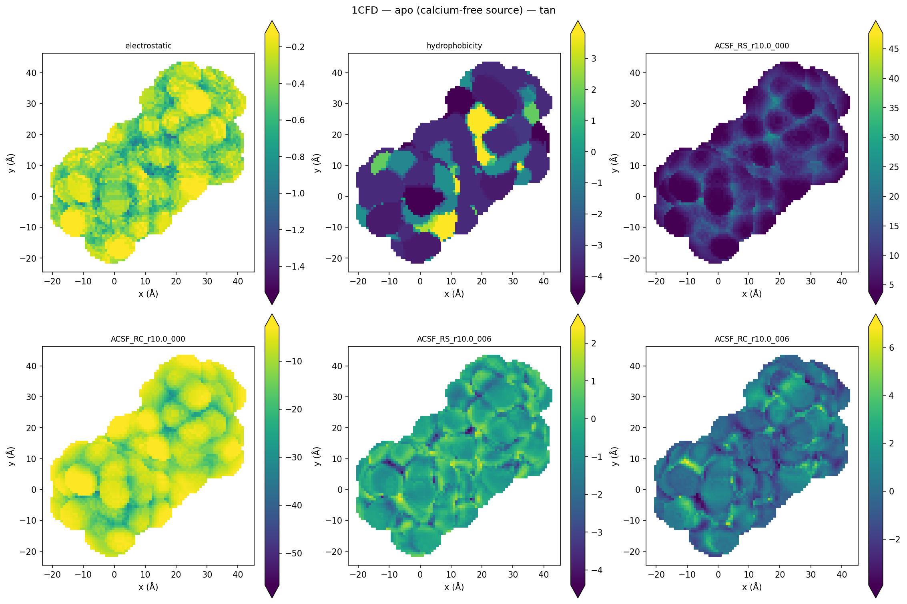
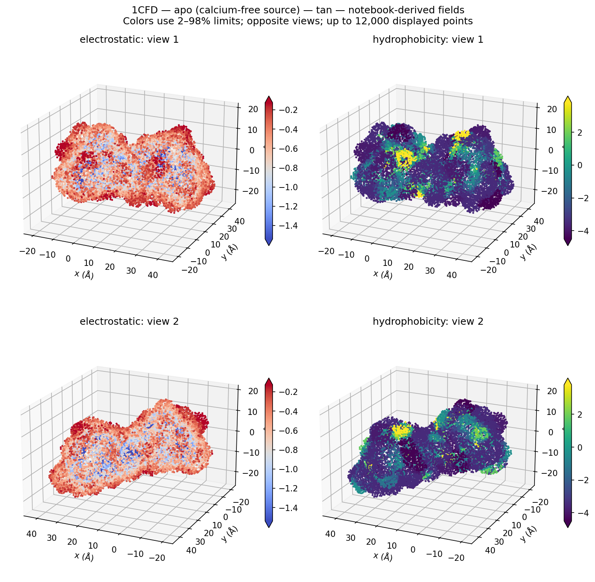
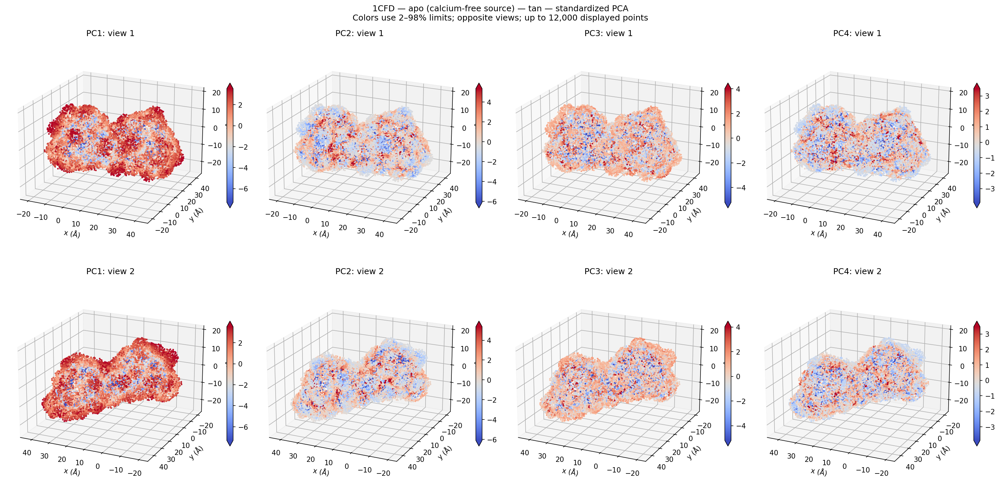
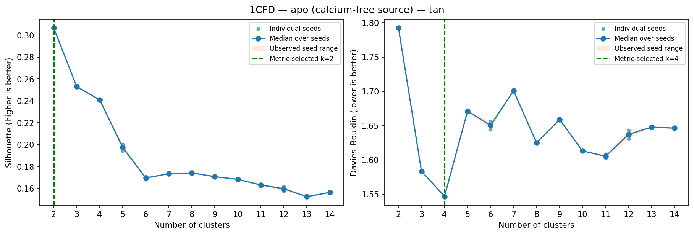
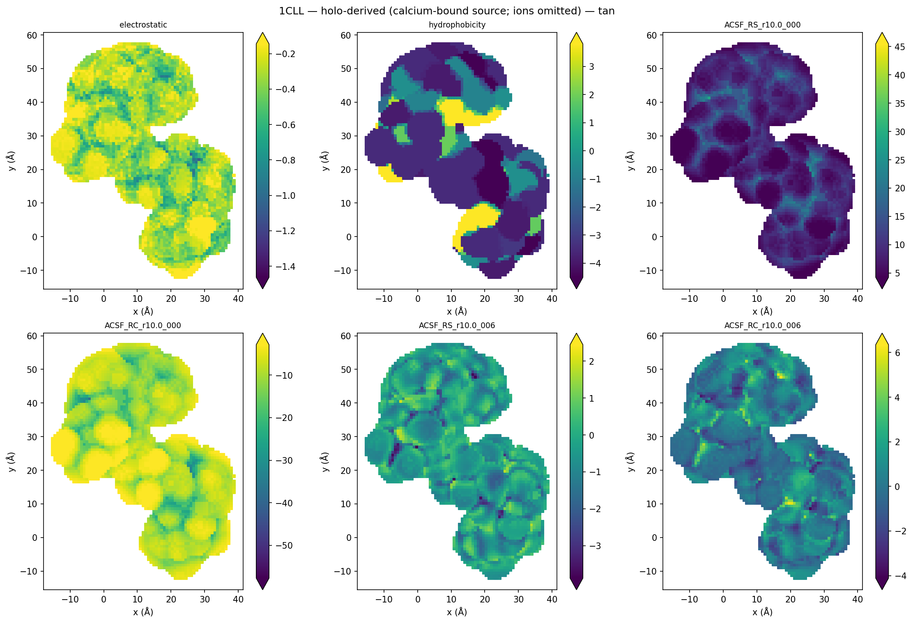
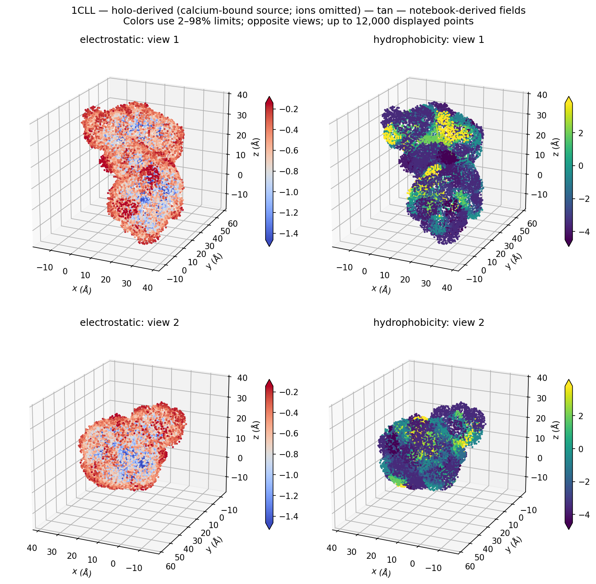
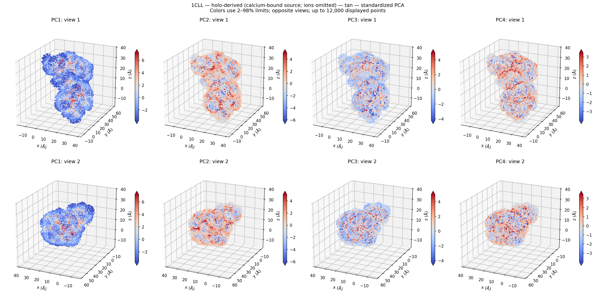
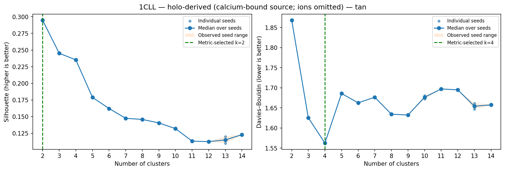

# Aperiodic protein examples

| Input | Source conformation | Calculation selection |
|---|---|---|
| [1CFD](https://www.rcsb.org/structure/1CFD) | Apo / calcium-free calmodulin | Protein heavy atoms, model 0 |
| [1CLL](https://www.rcsb.org/structure/1CLL) | Holo / calcium-bound calmodulin | Protein heavy atoms, calcium/water removed: **holo-derived** |

Use active `mapsy.biomapsy` (`biomapsy.py`). Both examples are aperiodic; no MIC or periodic protein images. Original PDB coordinates are retained. These source conformations differ in experimental context and atom selection, so the comparison is descriptive, not a controlled calcium-binding experiment.

The calmodulin notebook follows the same descriptors → PCA → K curves → selected maps sequence as the surfaces. It runs both states with both `tan` and `ionic-ass`, compares states with one pooled PCA basis, and performs a same-point angular/physicochemical descriptor ablation.

Default AC: radius=10 Å, orders=0–11, radial structural/compositional (24 coefficients). The full workflow includes two additional channels from the original extended notebook:

- `electrostatic`: sum q_i/max(r_i,0.1 Å) for r_i≤8 Å. The original heavy-atom charge lookup and generic-backbone/zero fallback are retained. It is not a complete ff14SB force-field assignment or a calibrated potential; hydrogens, termini, protonation and calcium are not modeled. Lookup coverage is recorded.
- `hydrophobicity`: sum KD_i/r_i divided by sum 1/r_i within 5 Å, with the same 0.1 Å floor. Each atom inherits its residue’s Kyte–Doolittle value, so this is atom-weighted, not an equal-residue average. [Original scale](https://doi.org/10.1016/0022-2836(82)90515-0).

PDB names/residues are matched in exact ASE coordinate/order before assigning properties; mismatches are rejected. The formulas are batched NumPy versions of the original notebook formulas and are tested against scalar calculations.

`--descriptor-set mixed` adds angular AC to a full run. The tutorial also compares radial, radial+fields, mixed, mixed+fields on identical 512-point subsets. Those controls retain one k only to isolate descriptor choices, clearly recorded; the main full-surface workflow selects k from its own complete 2–14 sweep. `--no-physicochemical` disables the two extra channels. `--comparison-k` adds a labeled user comparison. `--ntries` controls metric repeat seeds.

PCA plots show score variation, loadings and opposite 3D views; the optional front-facing 2D maps select maximum z per x,y pixel. Robust 2–98% color limits and seeded display subsets are recorded. Full values remain in CSV. Independent PCA maps should not be compared as identical axes; the state comparison fits a common pooled scaler/basis.

`tan`: grid_resolution=.8 Å, padding=10 Å, distance=3.5 Å, spread=.5 Å, threshold=.05 relative. `ionic-ass`: cutoff=7 in the existing grid convention, alpha=.8, spread=.5, threshold=.7 absolute. Retain the main connected region and record counts. Different modes need not produce the same point sets. Fits/DB use all rows; silhouette above 6000 points uses a recorded 2000-point subset.

The recorded backend refers to AC evaluation. Physicochemical fields run in batched CPU NumPy; their time/backend are recorded separately, and descriptor_seconds includes both sets. The standalone performance benchmark isolates AC computation.

## Protein figure gallery

### Apo calmodulin — 1CFD

### Holo-derived calmodulin — 1CLL

### Complete results and alternative contact model

| Conformation | tan: all channels, PCA, metrics and partitions | ionic-ass: all channels, PCA, metrics and partitions |
|---|---|---|
| Apo 1CFD | [Complete gallery](../preview/1CFD_tan/README.md) | [Complete gallery](../preview/1CFD_ionic-ass/README.md) |
| Holo-derived 1CLL | [Complete gallery](../preview/1CLL_tan/README.md) | [Complete gallery](../preview/1CLL_ionic-ass/README.md) |

[Shared-basis apo/holo PCA and field distributions](../preview/apo_holo_comparison/README.md). [Controlled CPU/GPU results](../preview/cpu_gpu/README.md).

## Verified extended protein analysis

The [extended notebook and figure gallery](extended_analysis/README.md) now completed from beginning to end in a fresh kernel. It includes the 52-channel larger-radius/order AC formulation plus physicochemical fields, PCA/UMAP, both clustering metrics, spatial partitions, connectivity, per-cluster comparisons, LDA and KS analyses. Full AC descriptors were compared against the previous extended results. Exact atom/property alignment and training-fold classification scaling were corrected; the gallery documents their consequences.
