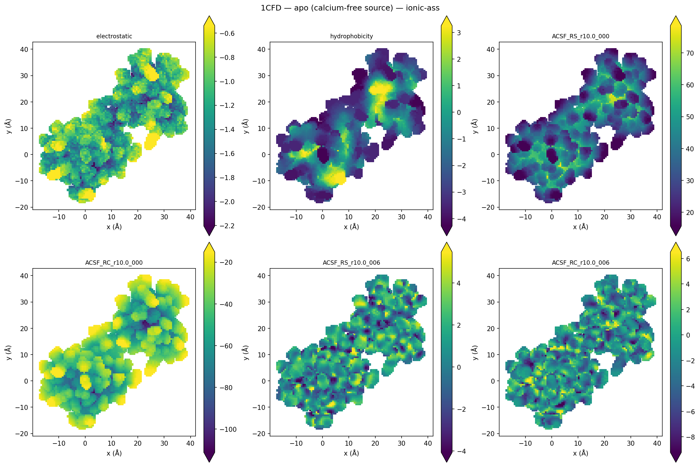
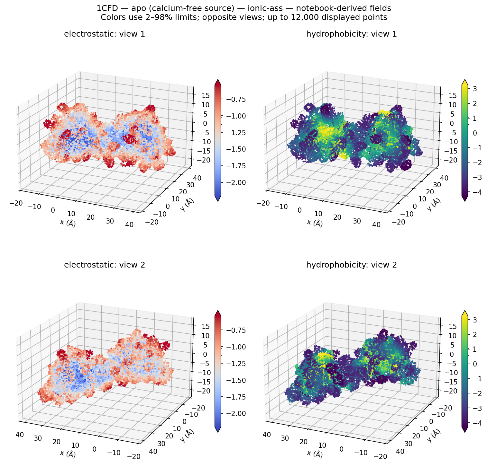
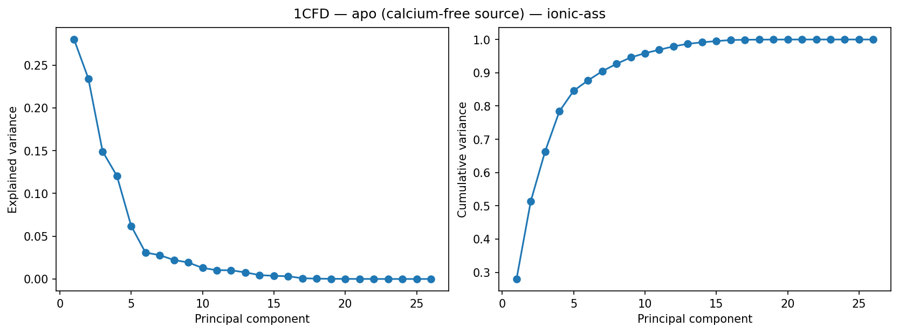
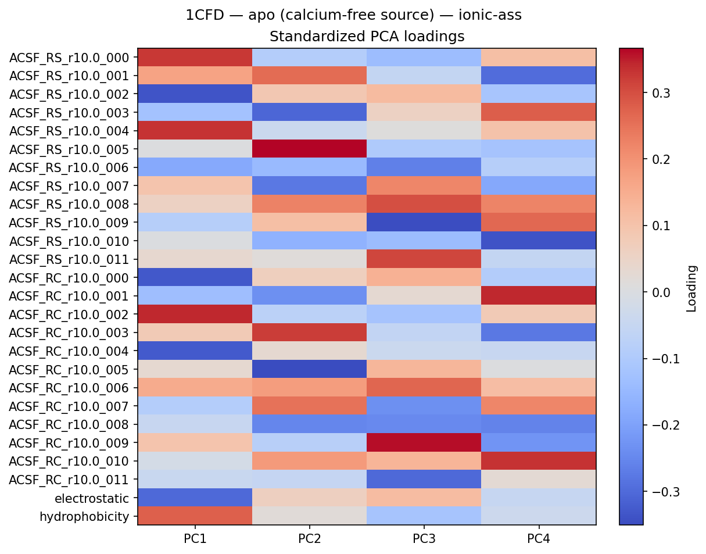
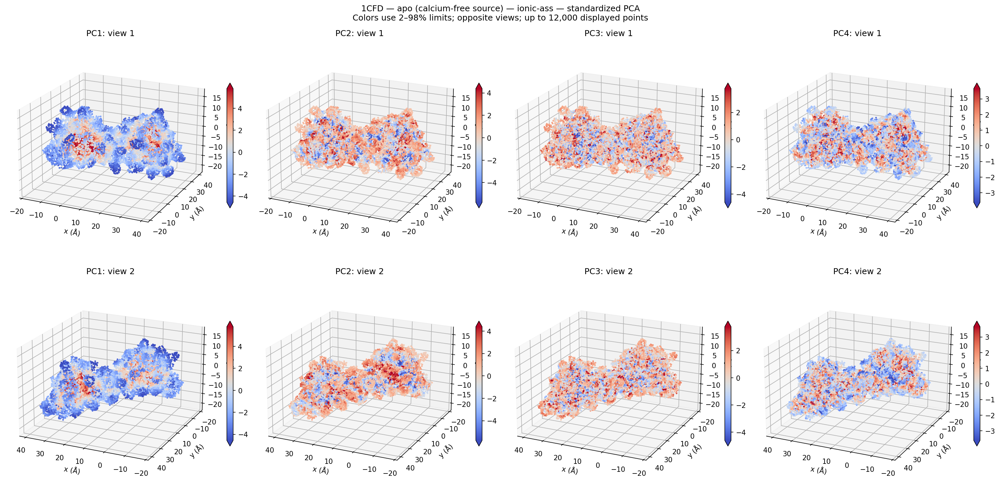
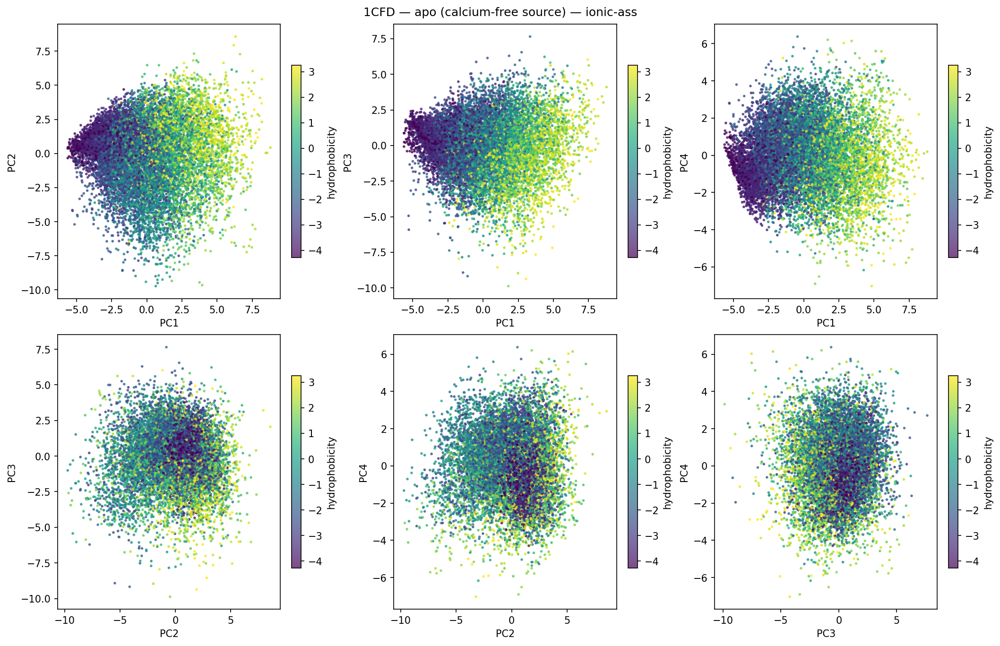
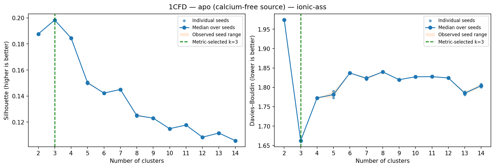
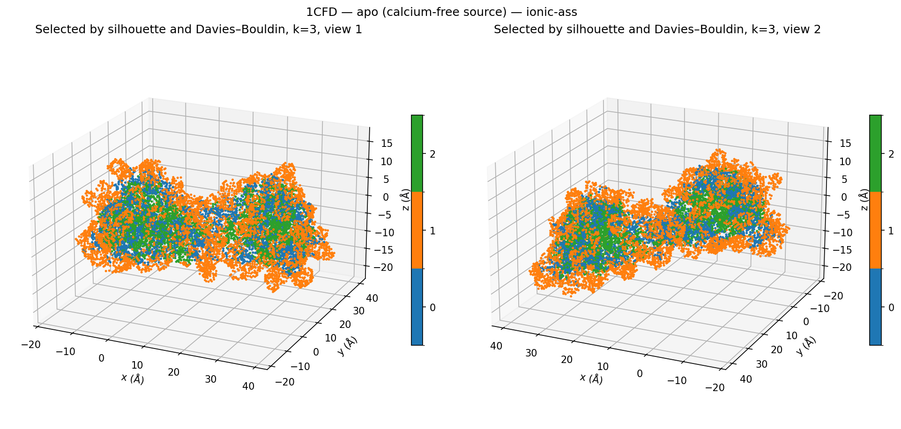

# 1CFD — apo (calcium-free source) — ionic-ass

36,842 points; 26 features; kmeans in standardized descriptor space.

## Descriptor maps

Every coefficient: [descriptor_panel_01](descriptor_panel_01.png), [descriptor_panel_02](descriptor_panel_02.png), [descriptor_panel_03](descriptor_panel_03.png)

## PCA

## Cluster-count curves

Median-over-two-seed choices: silhouette k=3, DB k=3. Values and all trials: [measured tables](../../measurements/1CFD_ionic-ass/clustering_metrics.csv).

## Partition selected by both metrics

