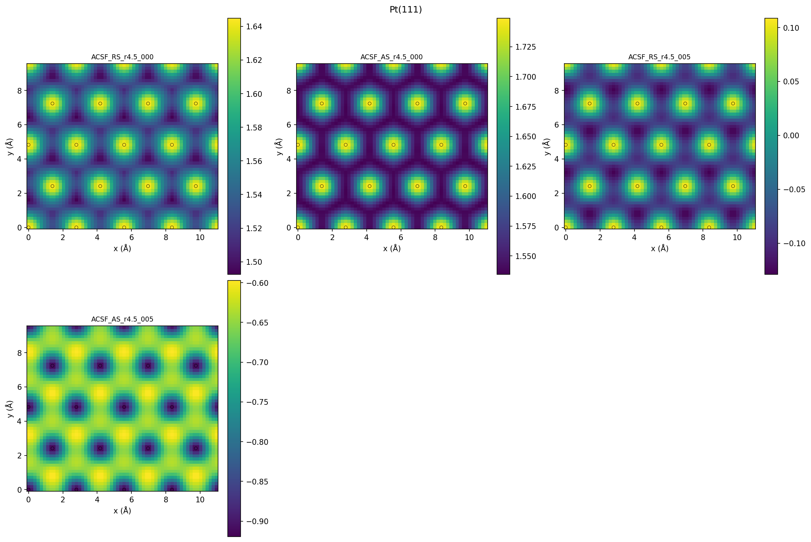
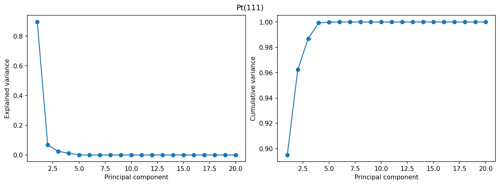
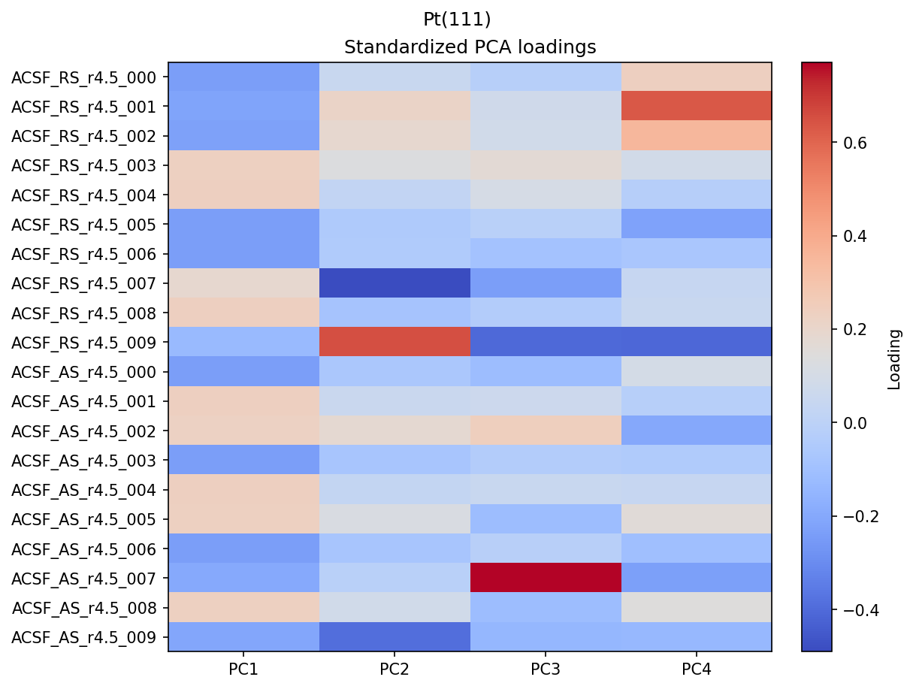
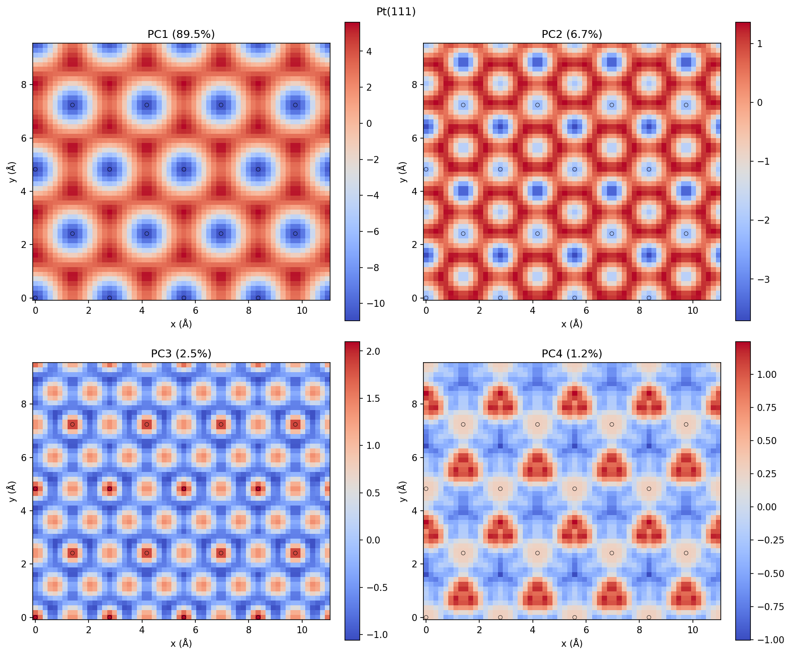
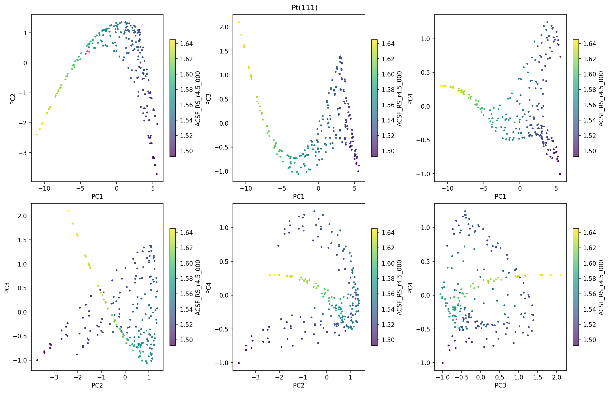
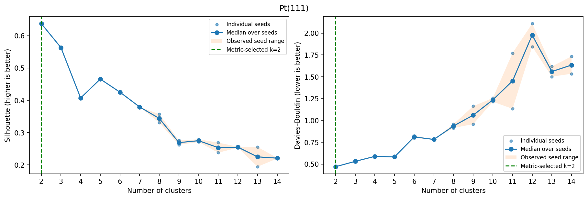
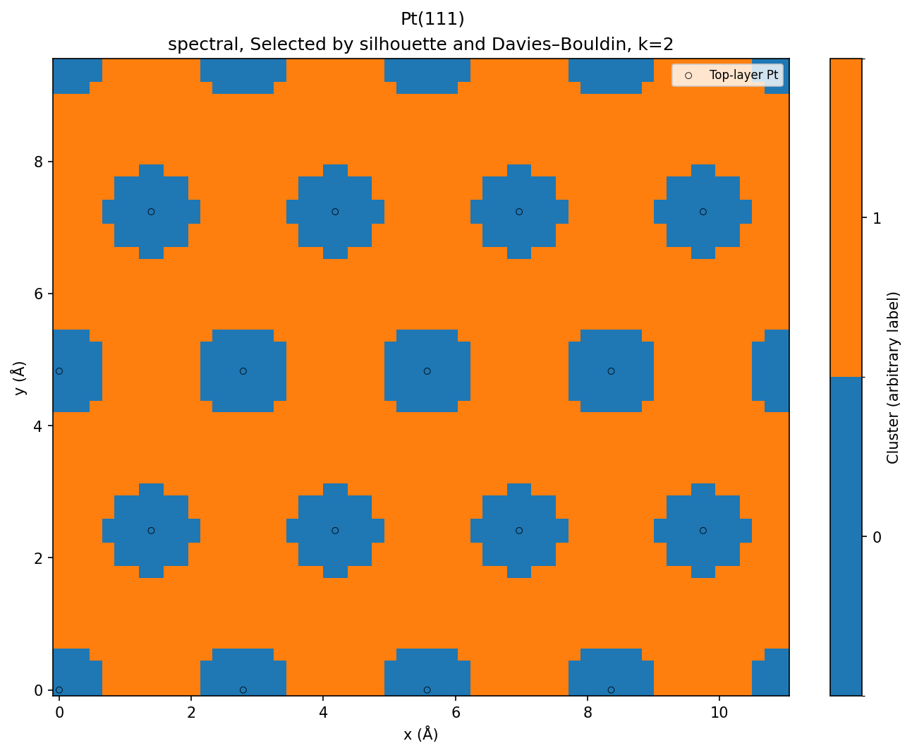

# Pt(111)

3,240 points; 20 features; spectral in raw descriptor space.

## Descriptor maps

Every coefficient: [descriptor_panel_01](descriptor_panel_01.png), [descriptor_panel_02](descriptor_panel_02.png)

## PCA

## Cluster-count curves

Median-over-two-seed choices: silhouette k=2, DB k=2. Values and all trials: [measured tables](../../measurements/Pt111/clustering_metrics.csv).

## Partition selected by both metrics

