# Pt(111) with vacancies and O

81,000 points; 40 features; kmeans in standardized descriptor space.

## Descriptor maps

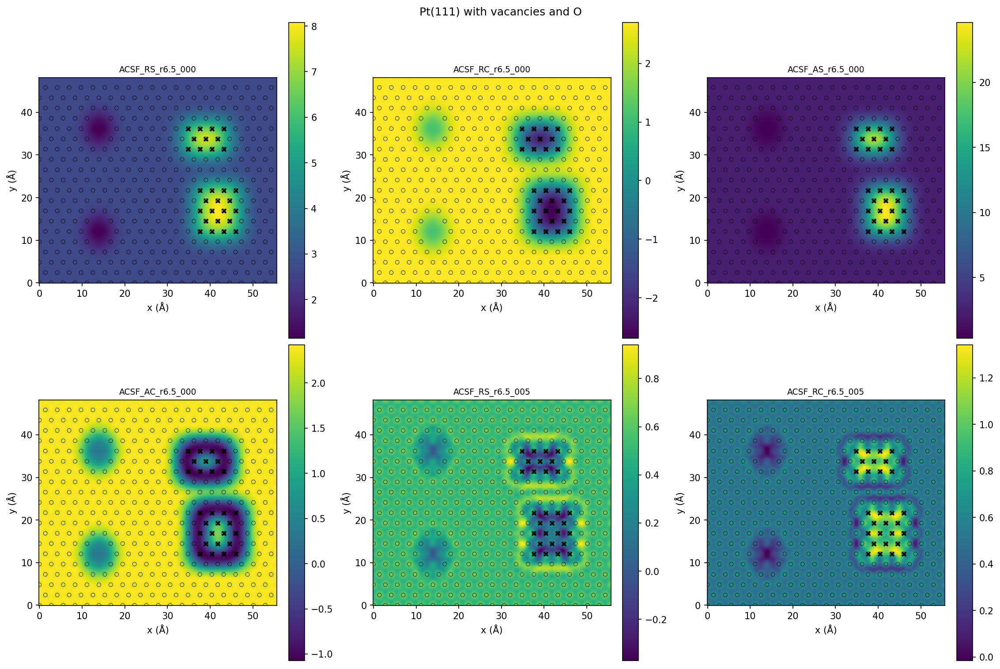

Every coefficient: [descriptor_panel_01](descriptor_panel_01.png), [descriptor_panel_02](descriptor_panel_02.png), [descriptor_panel_03](descriptor_panel_03.png), [descriptor_panel_04](descriptor_panel_04.png)

## PCA

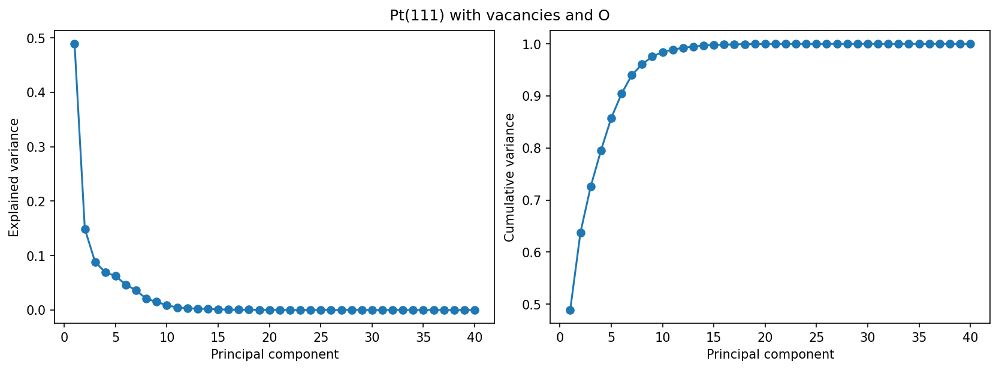

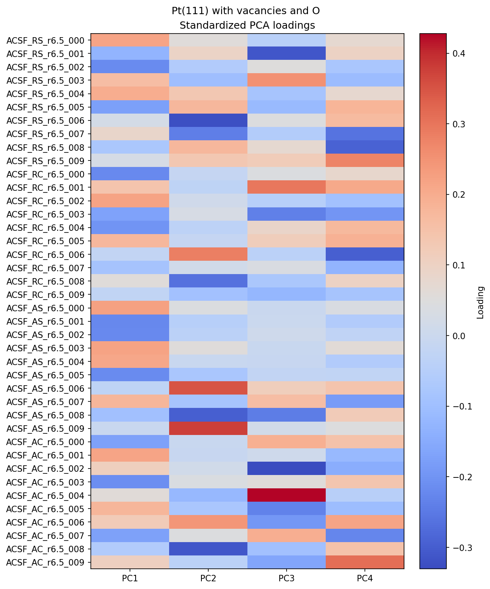

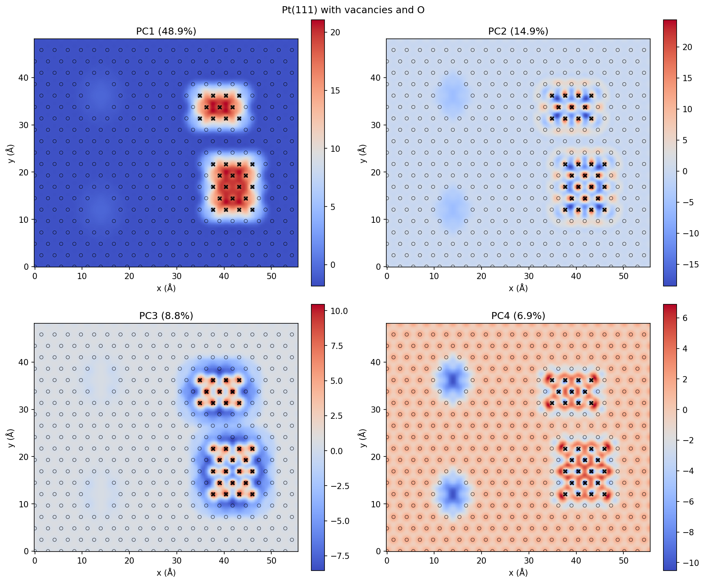

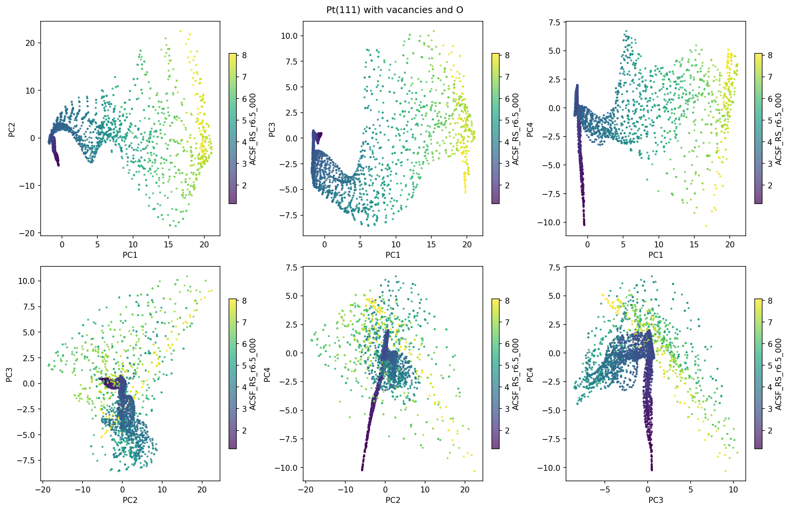

## Cluster-count curves

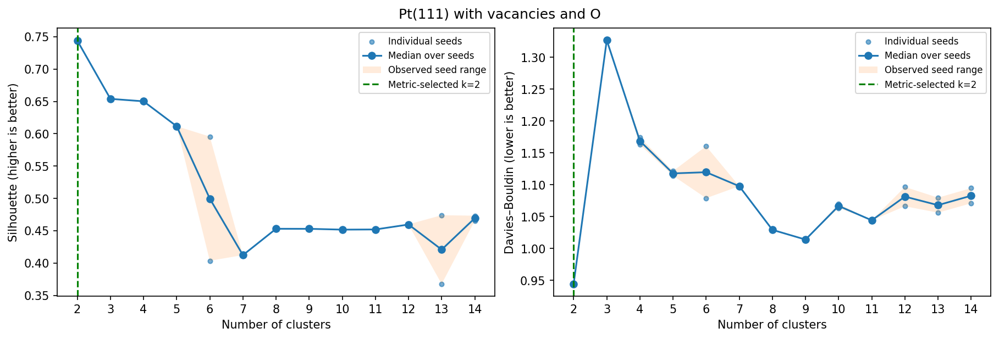

Median-over-two-seed choices: silhouette k=2, DB k=2. Values and all trials: [measured tables](../../measurements/Ptdefects/clustering_metrics.csv).

## Partition selected by both metrics

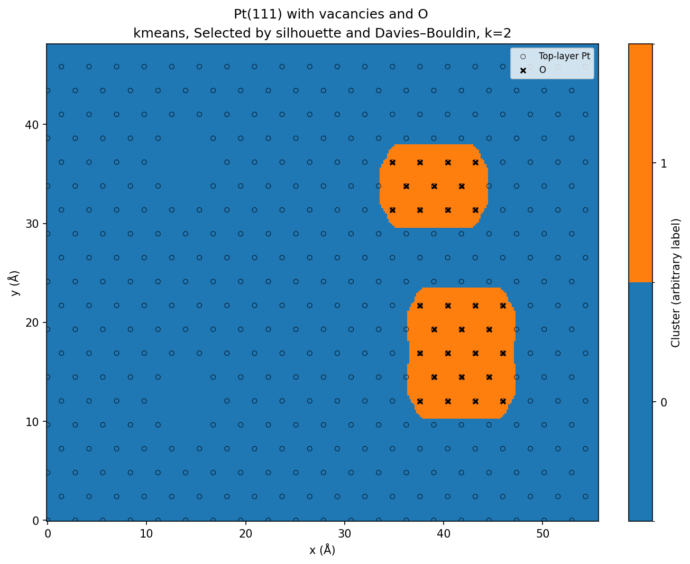

## Higher-resolution descriptor comparison

The k=2 metric optimum merges substantial descriptor variation. A separate fidelity and seed-agreement study supports showing **k=32** alongside k=2 and k=10. It does not resolve every known site family. Read the [short explanation](CLUSTER_RESOLUTION.md) for the mathematical criterion, held-out checks and limitations.

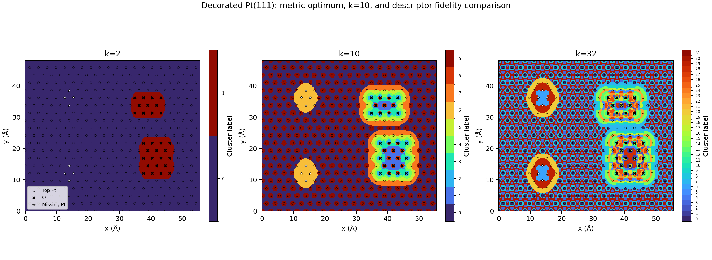

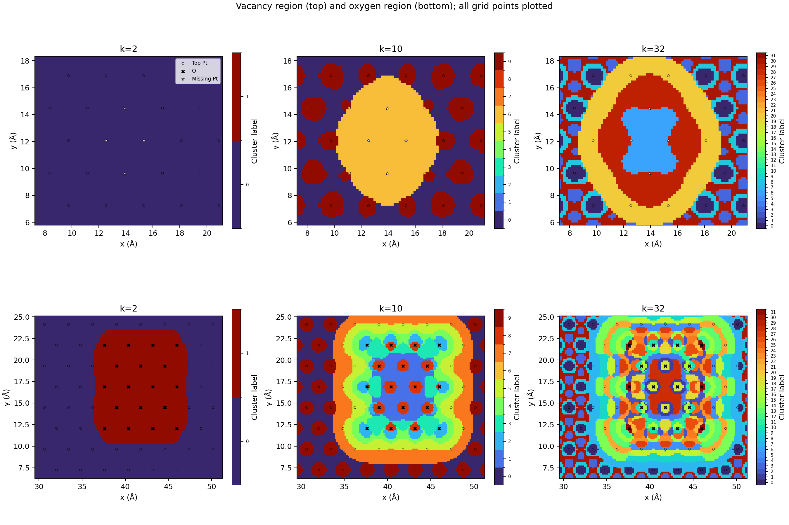

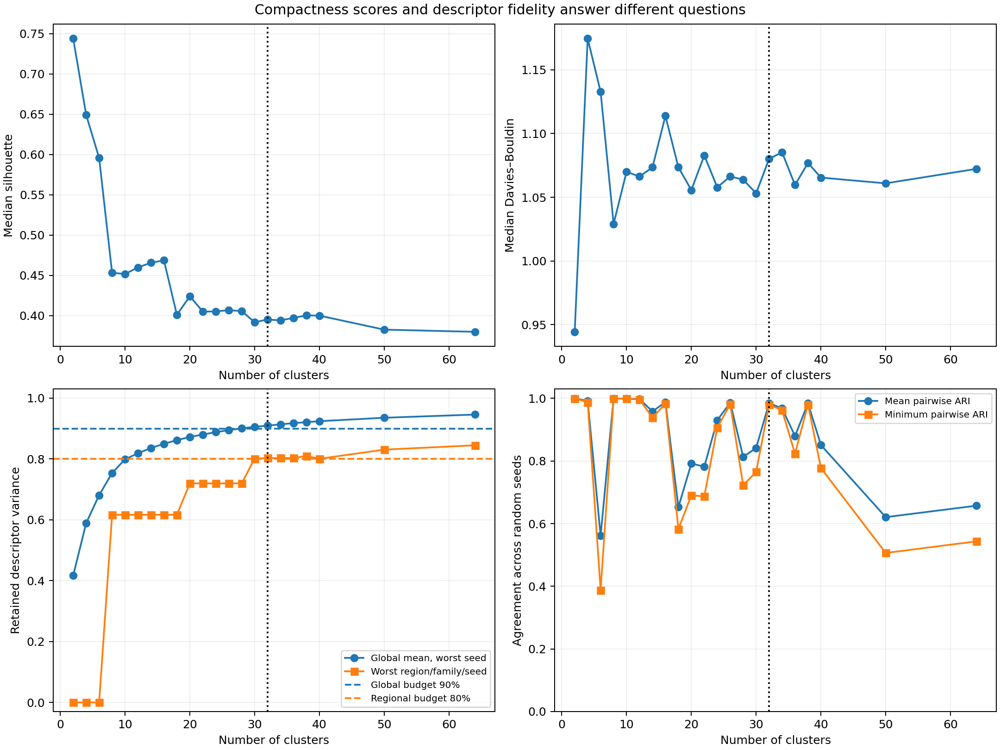

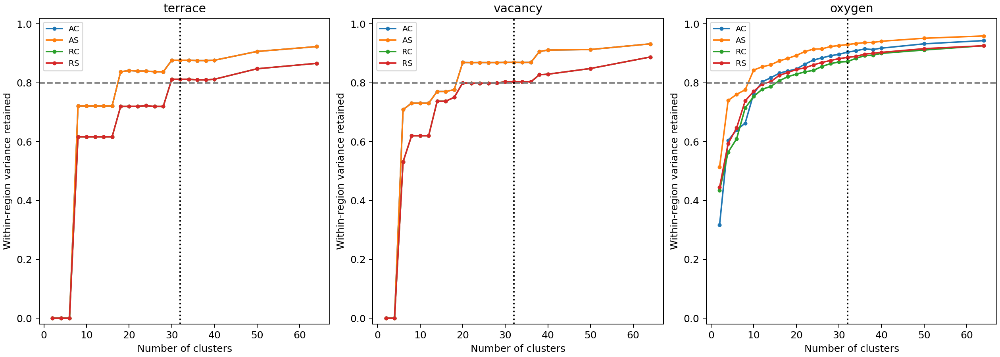
