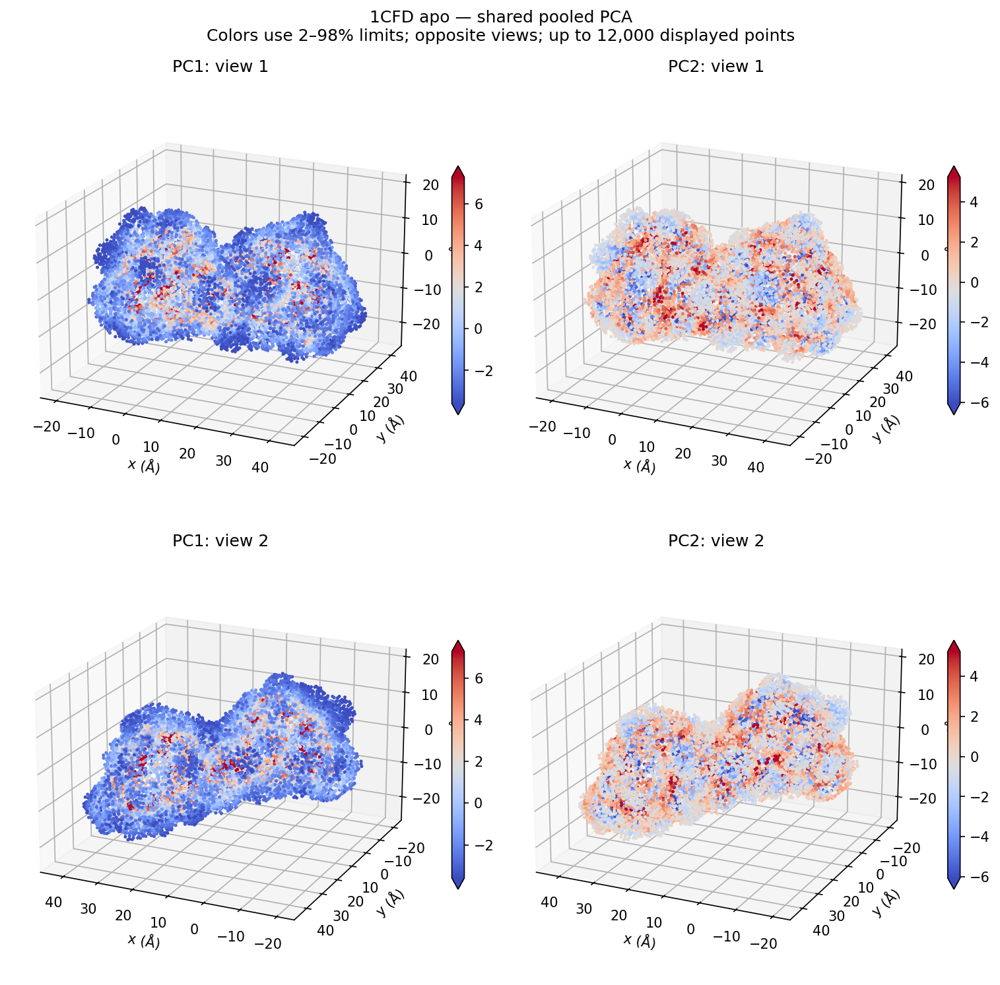
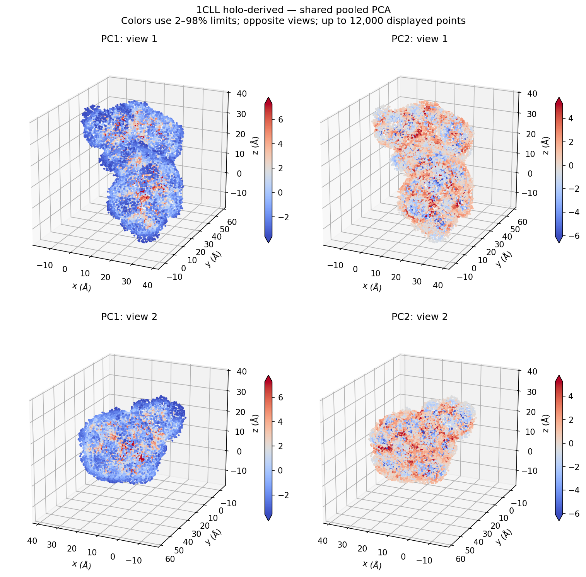
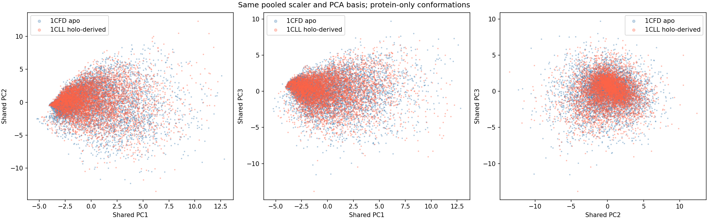
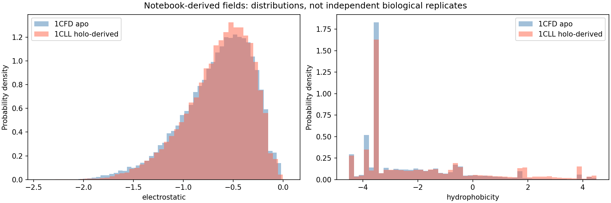

# Shared apo/holo-derived comparison

One pooled scaler and one pooled PCA basis for both protein-only tan surfaces, with common color limits. Per-state PCA axes are independently fitted; this comparison provides a common basis. It does not isolate calcium chemistry.

