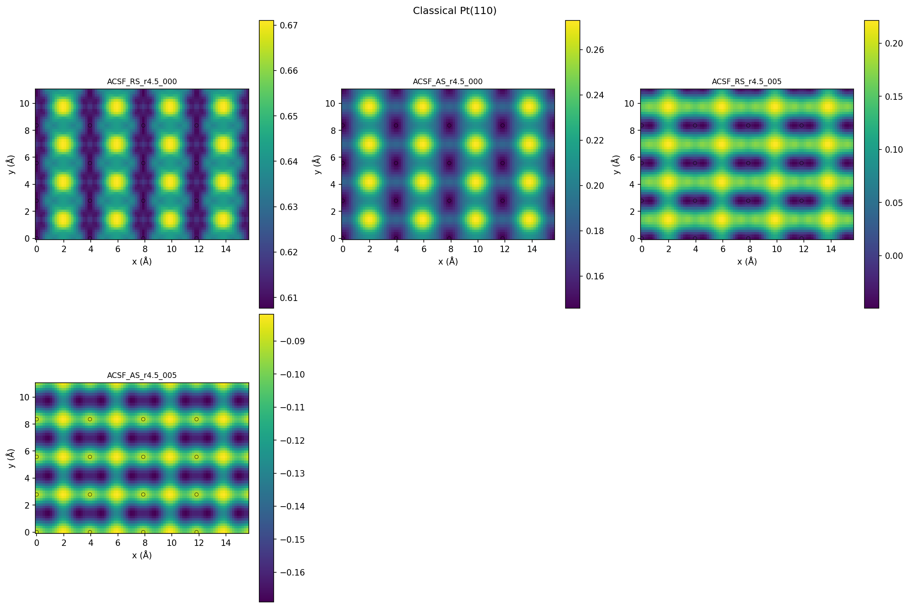
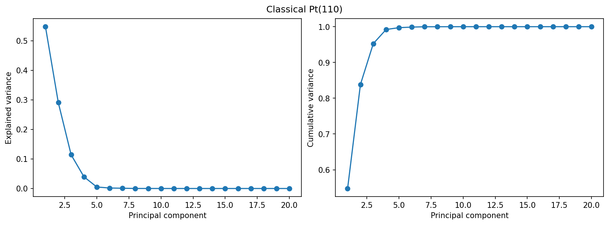
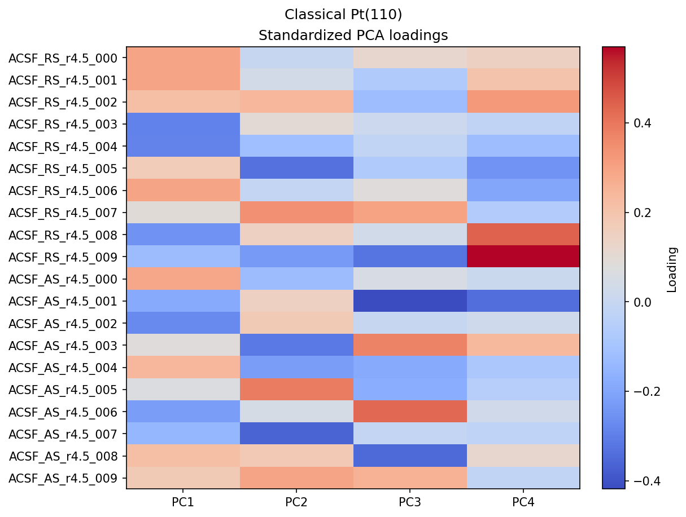
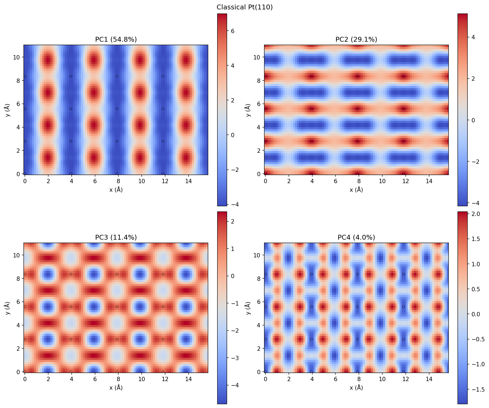
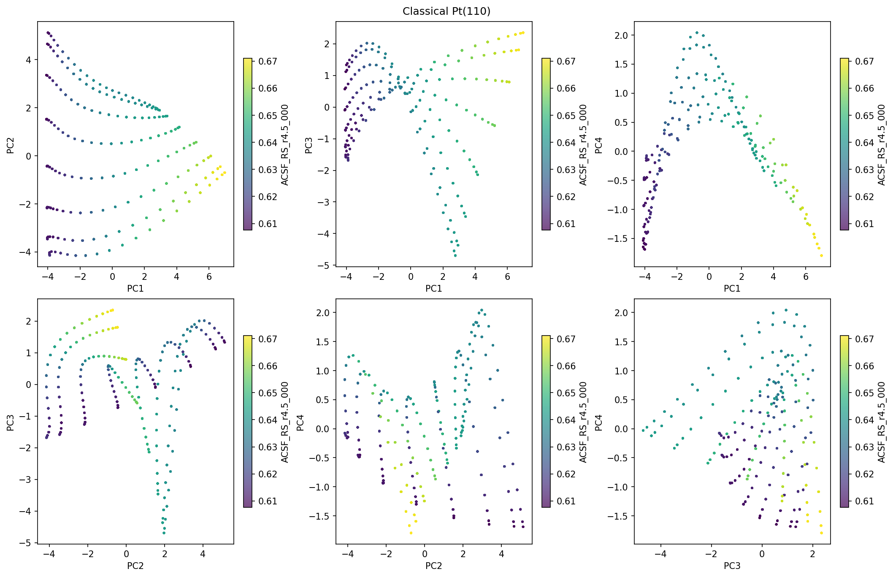
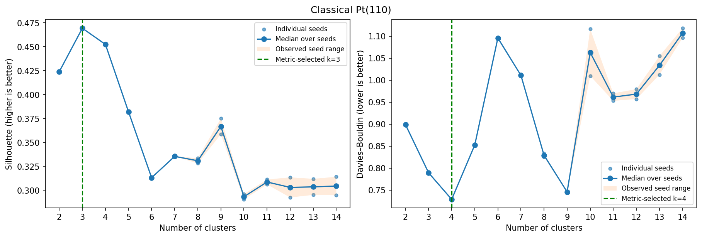
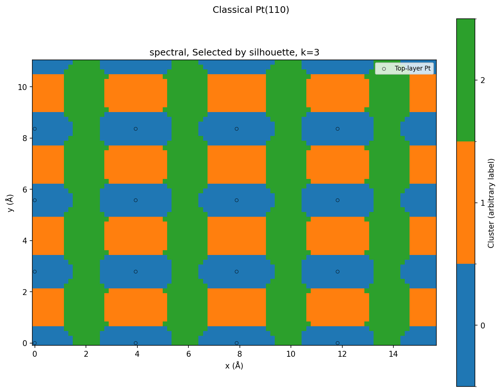
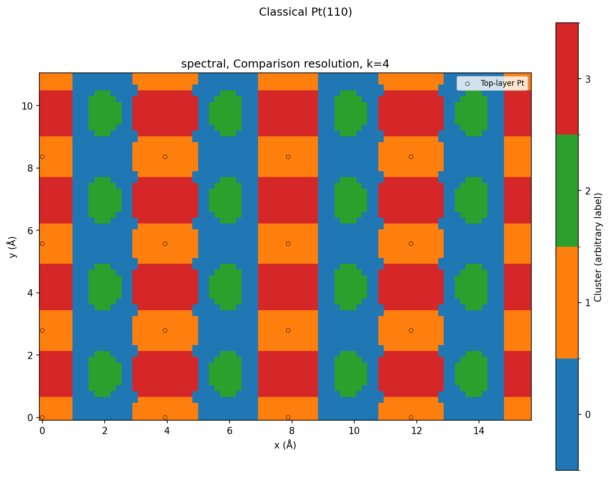

# Classical Pt(110)

5,400 points; 20 features; spectral in raw descriptor space.

## Descriptor maps

Every coefficient: [descriptor_panel_01](descriptor_panel_01.png), [descriptor_panel_02](descriptor_panel_02.png)

## PCA

## Cluster-count curves

Median-over-two-seed choices: silhouette k=3, DB k=4. Values and all trials: [measured tables](../../measurements/classical_Pt110/clustering_metrics.csv).

## Silhouette-selected partition

## Davies–Bouldin-selected partition

## Classical comparison resolution

Resolution used in the original planar_maps_ideal notebook; not an automatically selected optimum

