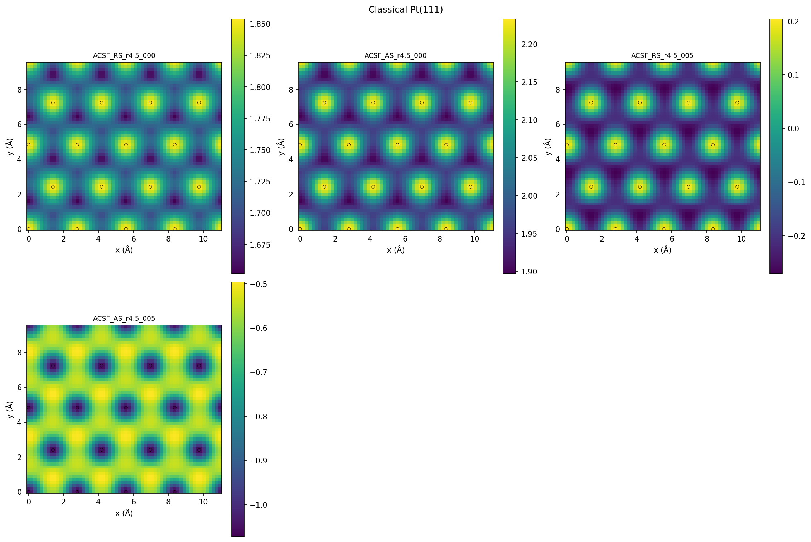
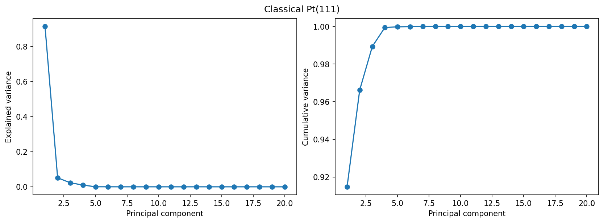
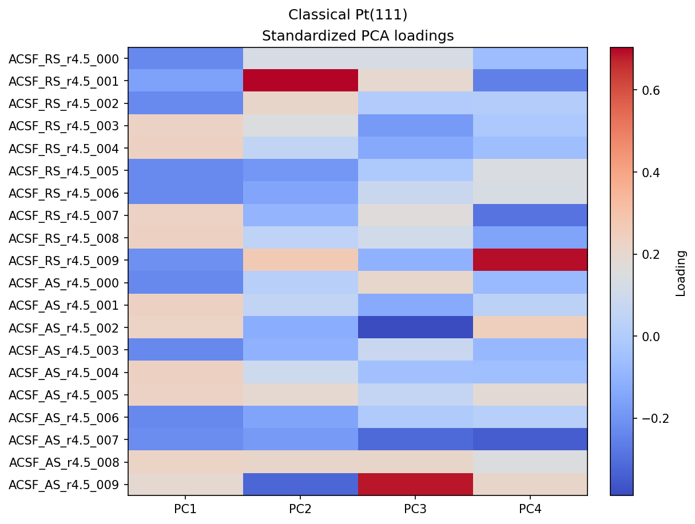
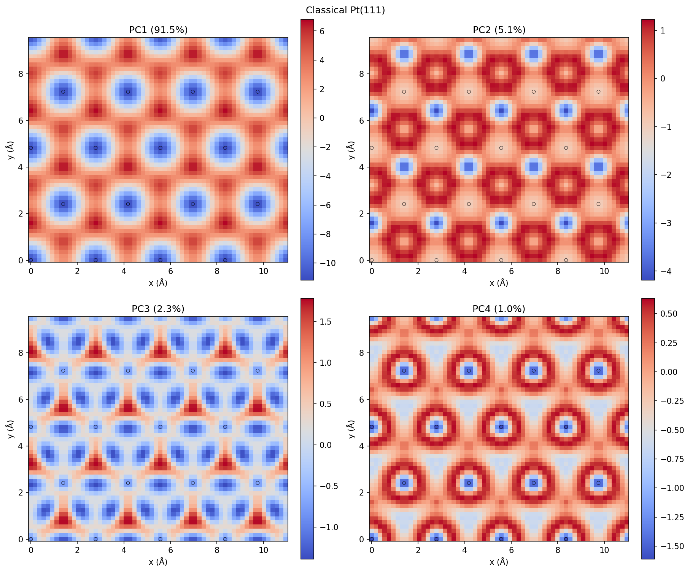
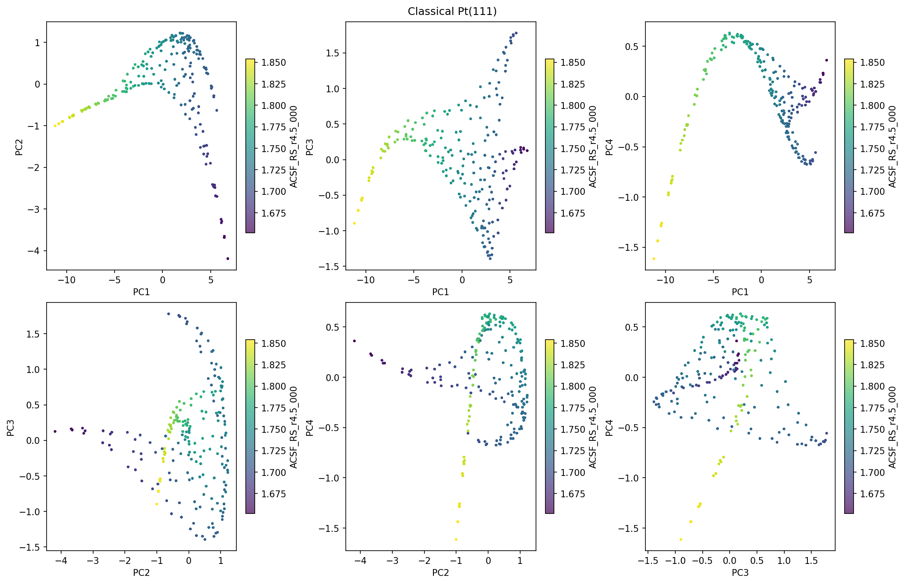
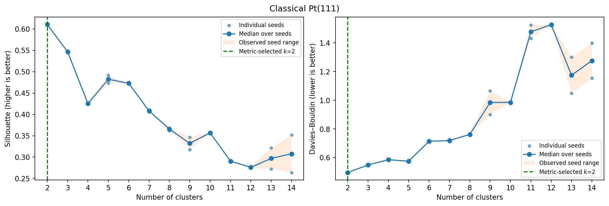
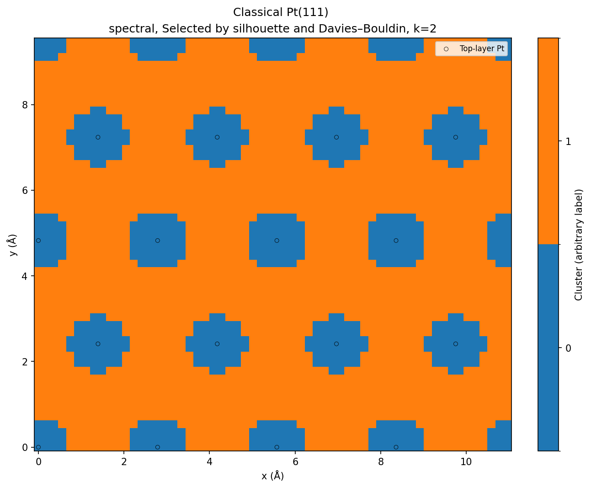
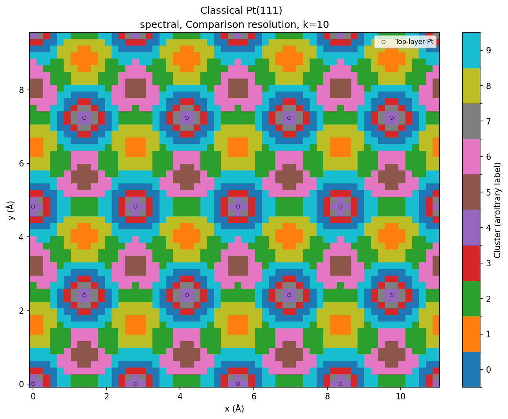

# Classical Pt(111)

3,240 points; 20 features; spectral in raw descriptor space.

## Descriptor maps

Every coefficient: [descriptor_panel_01](descriptor_panel_01.png), [descriptor_panel_02](descriptor_panel_02.png)

## PCA

## Cluster-count curves

Median-over-two-seed choices: silhouette k=2, DB k=2. Values and all trials: [measured tables](../../measurements/classical_Pt111/clustering_metrics.csv).

## Partition selected by both metrics

## Classical comparison resolution

Resolution used in the original planar_maps_ideal notebook; not an automatically selected optimum

## Known-site check

At seed42, the original comparison resolution k10 separates atop, bridge, fcc and hcp at the checked anchor locations. Both metric-selected k2 partitions merge site families. The measured site-discrimination/equivalence scores are0.5/1.0 for k2 and1.0/1.0 for k10. These assignments use nearest grid points; the exact-site descriptor symmetry and query offsets are recorded separately. This does not establish completeness over the continuous plane.

[Site assignments](../../measurements/classical_Pt111/site_assignments.csv) · [Anchor geometry/offsets](../../measurements/classical_Pt111/site_anchors.csv) · [Exact-site descriptor distances](../../measurements/classical_Pt111/site_descriptor_distances.csv).
