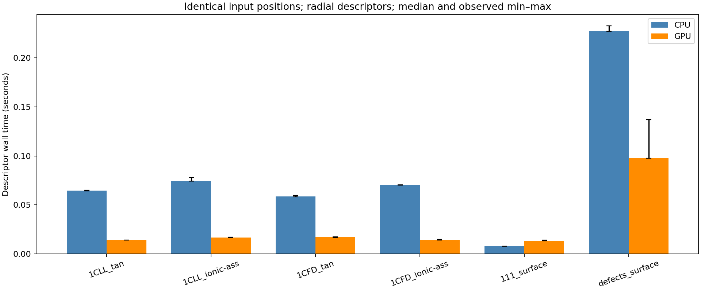

# Identical-input AC benchmark

2048 identical query positions per case; one warm-up and three synchronized repeats on an RTX4070 Laptop GPU. Contact/model construction and CPU physicochemical fields are excluded.

| case | cpu_median | gpu_median | cpu_over_gpu | max_abs_difference | cpu_gpu_kmeans_ARI |
| --- | --- | --- | --- | --- | --- |
| 1CLL_tan | 0.06476 | 0.01415 | 4.576 | 2.132e-14 | 1 |
| 1CLL_ionic-ass | 0.07485 | 0.01679 | 4.459 | 2.842e-14 | 1 |
| 1CFD_tan | 0.05882 | 0.017 | 3.46 | 2.132e-14 | 1 |
| 1CFD_ionic-ass | 0.07039 | 0.01413 | 4.982 | 4.263e-14 | 1 |
| 111_surface | 0.00781 | 0.01324 | 0.5898 | 6.661e-16 | 1 |
| defects_surface | 0.2275 | 0.09762 | 2.331 | 1.776e-15 | 1 |

A ratio below1 means CPU was faster. [Complete conditions and trials](../../measurements/benchmark.json).
